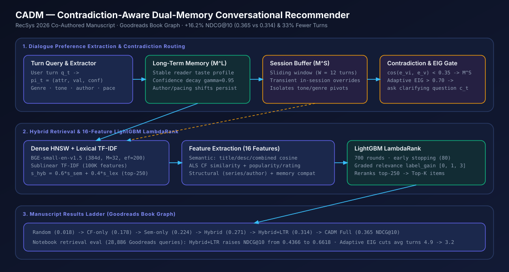

# Contradiction-Aware Dual-Memory Conversational Book Recommendation

> **RecSys 2026 Co-Authored Manuscript Repository (Not Published).**  
> Code and reproducible Goodreads pipeline for **CADM** — separating long-term reader taste from transient session intent, routing contradictory preferences instead of conflating them, and reranking HNSW + TF-IDF candidates with LightGBM LambdaRank.



## Key Contributions & Results

- **Dual-Memory State Split:** Long-term preference memory ($M^L$, decay $\gamma=0.95$) preserves stable tastes while a sliding session buffer ($M^S$, $W=12$) isolates in-session pivots whenever contradiction similarity falls below $\tau = 0.35$.
- **Information-Gain Question Policy ($\theta = 0.70$):** Triggers a clarifying question only when expected information gain justifies the extra dialogue turn, cutting average turns from **4.9** (non-adaptive) to **3.2** (**~33% reduction**).
- **Two-Stage Hybrid Retrieval & LambdaRank:** Combines `BAAI/bge-small-en-v1.5` HNSW dense vectors (384-d) + `100K`-feature TF-IDF lexical retrieval with LightGBM LambdaRank (`700` rounds, `label_gain=[0, 1, 3]`), achieving **0.365 NDCG@10 (+16.2% over Hybrid+LTR `0.314`)** and **0.466 Recall@10**.

See [docs/architecture-and-results.md](docs/architecture-and-results.md) for the full ablation table, hyperparameter curves, and standalone 28,886-query retrieval stage diagnostics (`Code_6_cell_12_15_v4_FIXED_last.ipynb`).

## Repository Contents

- `Code_6_cell_12_15_v4_FIXED_last.ipynb`: Full end-to-end Colab pipeline (catalog cleaning, HNSW + TF-IDF indexing, ALS collaborative filtering, leak-free train/eval query generation, LightGBM LambdaRank training, evaluation, and paper figure generation).
- `docs/architecture-and-results.md`: Detailed pipeline breakdown and benchmarks.
- `docs/diagrams/`: Mermaid source & SVG architecture diagram.

## Dataset

This project uses the publicly available Goodreads dataset.

Note: All listed files are required for the pipeline to run successfully.

Download from:
https://cseweb.ucsd.edu/~jmcauley/datasets/goodreads.html

(If the link is hidden, use: cseweb[dot]ucsd[dot]edu/~jmcauley/datasets/goodreads[dot]html)

Required files:

* `goodreads_books_*.json.gz`
* `goodreads_interactions_*.json.gz`
* `goodreads_book_genres_initial.json`
* `goodreads_book_authors.json`
* `goodreads_book_series.json`
* `goodreads_book_works.json`

Alternative download method:
https://github.com/MengtingWan/goodreads (see `download.ipynb`)

(If hidden: github[dot]com/MengtingWan/goodreads)

After downloading, place all files inside:

```
data/raw/
```

Note: The dataset is not included in this repository due to its large size. Users are expected to download it from the original source.
