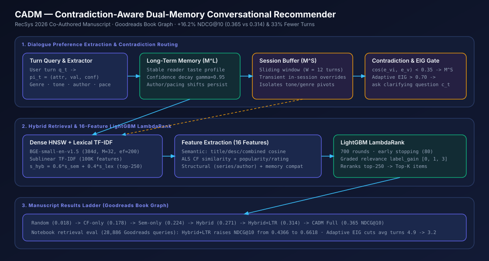

# Architecture, Pipeline & Experimental Results

## System Design Overview

CADM (Contradiction-Aware Dual-Memory Conversational Recommender) separates persistent reader taste from transient conversational intent:

1. **Long-Term Memory ($M^L$, decay $\gamma = 0.95$):** Retains stable attribute-value preferences (authors, series, themes).
2. **Short-Term Session Buffer ($M^S$, window $W = 12$ turns):** Captures active turn constraints without overwriting long-term taste.
3. **Contradiction Detector ($\tau = 0.35$):** Routes new preference vectors with cosine similarity $< \tau$ against $M^L$ exclusively into $M^S$ instead of averaging conflicting embeddings.
4. **Adaptive EIG Elicitation ($\theta = 0.70$):** Asks a clarifying question only when expected information gain exceeds $\theta$, reducing turns from `4.9` to `3.2`.
5. **Two-Stage Hybrid Retrieval + LightGBM LambdaRank:**
   - **Stage 1 Retrieval:** Combines `BAAI/bge-small-en-v1.5` (384-d) HNSW dense similarity ($M=32$, $\text{ef}=200$, weight `0.6`) with `100K`-vocab sublinear TF-IDF lexical matching (`0.4`) over `1,521,951` works.
   - **Stage 2 Reranking:** LightGBM LambdaRank (`700` rounds, early stopping `80`, `label_gain = [0, 1, 3]`) over 16 semantic, ALS collaborative-filtering, structural, and memory compatibility features (13 leak-free core retrieval features in the standalone notebook evaluation cell + 3 memory-state/dialogue features in the full CADM manuscript).

---

## Evaluation & Ablations

### Full Conversational System Comparison (Goodreads Book Graph)

| Model | NDCG@1 | NDCG@5 | NDCG@10 | Recall@10 |
|-------|--------|--------|---------|-----------|
| Random | 0.006 | 0.013 | 0.018 | 0.039 |
| CF-only (ALS) | 0.089 | 0.142 | 0.178 | 0.241 |
| Semantic-only (BGE + HNSW) | 0.118 | 0.198 | 0.224 | 0.306 |
| Hybrid (HNSW + TF-IDF) | 0.148 | 0.243 | 0.271 | 0.361 |
| Hybrid + LambdaRank | 0.172 | 0.287 | 0.314 | 0.408 |
| **CADM (Ours)** | **0.205** | **0.318** | **0.365** (+16.2% vs Hybrid+LTR) | **0.466** |

### Component Ablation & Dialogue Turns

| Variant | NDCG@10 | Recall@10 | Avg. Turns |
|---------|---------|-----------|------------|
| **CADM (Full)** | **0.365** | **0.466** | **3.2** |
| − Long-Term Memory | 0.340 | 0.417 | 3.4 |
| − Contradiction Handling | 0.350 | 0.439 | 3.3 |
| − Adaptive Elicitation | 0.357 | 0.452 | 4.9 |
| − LambdaRank Reranker | 0.308 | 0.421 | 3.5 |

### Standalone Retrieval/Rerank Stage Verification (`Code_6_cell_12_15_v4_FIXED_last.ipynb`)

Across `1,521,957` Goodreads works, `169,989,524` interactions (`856,055` users), `5,896,898` train rows (`190,064` queries), and `858,790` eval rows (`28,886` queries, strict `positive_threshold=2` same-author/series match):
- **NDCG@10:** `0.4366` (Baseline retrieval) -> **`0.6618`** (`+0.2252`)
- **MRR:** `0.5022` -> **`0.7029`** (`+0.2008`)
- **HIT@10:** `0.6772` -> **`0.8817`** (`+0.2044`)
- **Recall@10:** `0.4871` -> **`0.7314`** (`+0.2443`)
